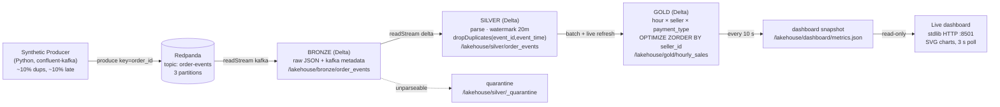

# Real-Time Streaming & Medallion Lakehouse Pipeline

**Redpanda (Kafka) → PySpark Structured Streaming → Delta Lake (Bronze / Silver / Gold)**

A production-shaped, 100%-local Medallion lakehouse that ingests real-time e-commerce order
events, cleanses and **deduplicates** them with event-time watermarks, and aggregates hourly
sales — with checkpointed fault tolerance and Delta `OPTIMIZE`/Z-ORDER compaction.

[](https://spark.apache.org/)
[](https://delta.io/)
[](https://redpanda.com/)
[](https://www.python.org/)
[](LICENSE)
[](https://github.com/saber2164/Real-Time-Streaming-Medallion-Lakehouse-Pipeline-/actions/workflows/demo-run.yml)

> **Docs:** [Architecture](docs/ARCHITECTURE.md) · [Concepts & Decisions](docs/CONCEPTS_AND_DESIGN_DECISIONS.md) · [Dashboard](docs/DASHBOARD.md) · [Runbook](docs/RUNBOOK.md) · [Showcase page](docs/index.html) · [Project memory](PROJECT_MEMORY.md)

---

## Architecture



```
 Producer ──produce──► Redpanda ──readStream──► BRONZE ──readStream(delta)──► SILVER ──batch──► GOLD
 (dup/late)          (order-events)            (raw+meta)                  (dedup, 20m wm)   (aggregates)
                                                                                              │
                                                                                    10 s refresh
                                                                                              ▼
                                                                              metrics.json ──► dashboard :8501
```

Only **Bronze** consumes Kafka; **Silver** reads the Bronze **Delta stream**, so the broker has
a single consumer and Silver can be rebuilt by replaying Bronze.

## Medallion layers & grain

| Layer | Path | What it holds | Grain |
|-------|------|---------------|-------|
| **Bronze** | `/lakehouse/bronze/order_events` | raw JSON (`raw_payload`) + `kafka_partition`, `kafka_offset`, `kafka_timestamp`, `ingest_date` | 1 row per Kafka record |
| **Silver** | `/lakehouse/silver/order_events` | parsed + typed event, `event_date`, `total_amount`; deduped | 1 row per unique `(event_id, event_time)` |
| **Gold** | `/lakehouse/gold/hourly_sales` | `hourly_order_count`, `total_revenue`, `avg_freight_cost` | 1 row per `(hour_start, seller_id, payment_type)` |
| **Quarantine** | `/lakehouse/silver/_quarantine` | unparseable JSON rows | 1 row per bad record |

Schemas, ports, and the full component map are in [`docs/ARCHITECTURE.md`](docs/ARCHITECTURE.md).

## Real measured results

Reproduced from [`PROJECT_MEMORY.md`](PROJECT_MEMORY.md); raw outputs in [`docs/assets/`](docs/assets).

| Metric | Value |
|--------|-------|
| Producer (60 s @ 50/s, seed 42) | `emitted=3277 duplicates=259 delayed=276 delivery_errors=0` |
| Bronze rows | **3277** (offsets contiguous: 1056 + 1170 + 1051) |
| Silver rows | **3018** = 3277 − 259 duplicates |
| Silver dedup check | 3018 == 3018 distinct `event_id` == 3018 distinct key; 0 bad `total_amount` |
| Gold rows | **60** (from 1055 `order_created` events) |
| Gold cross-check | 60 == 60 groups; revenue 269805.58 == 269805.58; 0 mismatched |
| OPTIMIZE active files | Bronze 3→1, Silver 4→1, Gold 1→1 |
| Recovery after `docker kill` | Silver 4315 == 4315 distinct `event_id`; offsets contiguous (1682/1809/1424) |

## Live dashboard (real numbers, graphs, auto-refresh)

A read-only stakeholder dashboard serves the Gold layer on
**http://localhost:8501**. It shows revenue, orders, average order value, top
sellers, payment mix, events per minute, revenue by hour, duplicates removed,
watermark/lateness and pipeline health. The page polls the API every **3
seconds** and never displays sample data.

```bash
scripts/live_dashboard.sh          # Redpanda + stream + refresher + dashboard + producer
# open http://localhost:8501
scripts/stop_live_dashboard.sh
```

`spark/gold_refresh.py` recomputes Gold from Silver, writes an **atomic**
`metrics.json`, and `dashboard/server.py` serves it with the Python standard
library only. `spark/gold_logic.py` is shared with the batch
`gold_compaction.py`, so the live view cannot drift from the batch Gold table.
The dashboard container mounts `./lakehouse` **read-only**.

Measured in an **isolated** live run (topic `order-events-dashboard`, separate
paths, stream started before the producer; `numRowsDroppedByWatermark = 0`):

| Snapshot | Bronze | Silver | Gold rows | Orders | Revenue | Newest arrival |
|----------|-------:|-------:|----------:|-------:|--------:|---------------:|
| t1 | 926 | 708 | 60 | 238 | 56,345.40 | 6.4 s |
| t2 | 1,726 | 1,438 | 60 | 519 | 128,841.28 | 6.9 s |
| final | 2,616 | 2,415 | 96 | 863 | 219,392.90 | 40.7 s |

Duplicates removed: **201** (7.68%); quarantine: **0**; Gold version advanced
`0 → 19` across **20 refreshes** (the committed API snapshot was captured at
version 11; counts were unchanged after version 9). Independent checks: Silver
2,415 = 2,415 distinct keys, Bronze distinct keys 2,415, bad amounts 0; Gold 96
rows, orders 863 = 863, revenue 219,392.90 = 219,392.90, mismatched groups 0.
Evidence:
[`docs/assets/dashboard_live_metrics.json`](docs/assets/dashboard_live_metrics.json),
[`dashboard_live_refresh.txt`](docs/assets/dashboard_live_refresh.txt),
[`dashboard_live_verify.txt`](docs/assets/dashboard_live_verify.txt). Full
design and limits in [`docs/DASHBOARD.md`](docs/DASHBOARD.md).

## Event time vs. processing time (worked example)

`event_time` is when the order happened; processing time is when Spark saw it. The producer
emits **late** events 2-15 minutes after their true time; the Silver query uses a
**20-minute watermark** — deliberately **wider** than the 15-minute maximum lateness:

```
event_time    arrives at    watermark now    outcome
-----------   -----------   --------------   ------------------------------------------
12:00:00      12:00:05      12:00:00         on time      -> parsed, dedup state kept
12:04:00      12:07:00      12:01:00         within wm    -> deduped normally
12:00:00      12:17:00      12:07:00         beyond wm    -> DROPPED (append dedup) -- so the
                                                             watermark must exceed max lateness
```

**Measured, not theoretical.** An earlier configuration used a **10-minute** watermark while
the producer delayed events up to 15 minutes. On a *live* run that **silently dropped 137
valid orders** (Bronze 3277 rows / 3018 distinct keys → Silver only 2879). Locally this was
hidden because the producer ran to completion *before* the stream started, so the whole
backlog landed before the watermark advanced. Sizing the watermark above the lateness (20 min)
fixes it: Silver now retains all 3018 distinct keys. Reproduce with
`scripts/watermark_report.py`. The trade-offs and tuning discussion live in
[`docs/CONCEPTS_AND_DESIGN_DECISIONS.md`](docs/CONCEPTS_AND_DESIGN_DECISIONS.md#14-event-time-vs-processing-time-watermarks-state-store-late-data).

## Why streaming is a batch problem in disguise (trade-offs & cost)

Structured Streaming is an **incremental batch loop**: each trigger is a small Spark job.
That is powerful, but it is not free.

| Dimension | Continuous streaming (this project) | Scheduled micro-batch (`trigger(availableNow=True)` every 15 min) |
|-----------|--------------------------------------|------------------------------------------------------------------|
| Latency | seconds | minutes (up to the interval) |
| Cost | a driver + executors running **24/7** | compute only during the run |
| Complexity | watermarks, state, checkpoints, backpressure | plain batch, simpler ops |
| Failure recovery | checkpoint replay, state store | re-run the job |
| Small files | many (one+ per micro-batch) → needs `OPTIMIZE` | one file set per run |
| Best when | latency SLO < ~1 min, continuous volume, event-time correctness matters | latency tolerance ≥ minutes, cost-sensitive, bursty/spiky volume |

**Decision rubric.** Choose **streaming** if a hard (sub-minute) freshness SLO drives the
business, events arrive continuously, and you have the operational maturity for stateful jobs.
Choose **scheduled micro-batches** if consumers are humans/dashboards that refresh every few
minutes, volume is bursty, or you want to minimise always-on cost — you keep Delta + the
Medallion model and drop most of the streaming complexity. In this project we deliberately ran
**continuous streaming** to exercise watermarks, state pruning, and micro-batch mechanics.

## Tech stack

| Component | Version | Role |
|-----------|---------|------|
| Redpanda | v24.3.10 | Kafka-API broker (3-partition `order-events`) |
| Redpanda Console | v2.8.4 | topic/broker UI on :8080 |
| Apache Spark | 3.5.3 (Scala 2.12, JDK 21) | Structured Streaming + batch |
| Delta Lake | 3.2.0 | ACID table format (Bronze/Silver/Gold) |
| spark-sql-kafka-0-10 | 3.5.3 | Kafka source |
| confluent-kafka (Python) | 2.3.0 | producer |
| Docker Compose | standalone | one-command local stack |

## Quickstart

```bash
# 1) Start the stack (Redpanda, Console, topic-init, Spark)
docker-compose build spark
docker-compose up -d
# Console: http://localhost:8080   -> shows topic "order-events" (3 partitions)

# 2) Emit events (60s @ 50/s, reproducible)
docker-compose run --rm producer python event_producer.py --duration 60 --rate 50 --seed 42
# -> emitted=3277 duplicates=259 delayed=276 delivery_errors=0

# 3) Stream Kafka -> Bronze -> Silver (Ctrl-C to stop gracefully)
docker-compose run --rm spark spark-submit \
  --packages org.apache.spark:spark-sql-kafka-0-10_2.12:3.5.3,io.delta:delta-spark_2.12:3.2.0 \
  /opt/spark/app/stream_ingestion.py

# 4) Gold aggregate + OPTIMIZE/ZORDER
docker-compose run --rm spark spark-submit --packages io.delta:delta-spark_2.12:3.2.0 \
  /opt/spark/app/gold_compaction.py

# 5) Optional: live dashboard + refresher + continuous producer
scripts/live_dashboard.sh
# open http://localhost:8501 ; stop with scripts/stop_live_dashboard.sh
```

Redpanda Console → http://localhost:8080 · Spark UI → http://localhost:4040 ·
Dashboard → http://localhost:8501 (after step 5).

## Run it in the cloud (free, on demand)

No local install needed: the whole pipeline (Redpanda → Spark → Bronze/Silver/Gold
→ verification) can run on **GitHub Actions** runners, triggered from the
[showcase page](docs/index.html) or the
[Actions tab](https://github.com/saber2164/Real-Time-Streaming-Medallion-Lakehouse-Pipeline-/actions/workflows/demo-run.yml):

1. **Actions → Cloud demo run → Run workflow** (optionally set duration/rate/seed).
2. The runner builds the images, boots Redpanda, streams events, builds Gold,
   generates a read-only dashboard snapshot, verifies the dashboard API, and
   uploads all evidence as artifacts.

The stream is bounded by `STREAM_IDLE_TIMEOUT_SECONDS` (stop once the pipeline
drains; `STREAM_MAX_SECONDS` is only a wall-clock backstop) so the job drains the
topic and exits cleanly instead of running forever. GitHub Pages is static
and a browser must never hold a secret, so the button opens GitHub's
authenticated *Run workflow* page — that login is the safety gate. Full details,
plus the optional one-click upgrade, in
[`docs/CLOUD_DEMO.md`](docs/CLOUD_DEMO.md).

A cloud run reproduces the local canonical result exactly. Verified run
[`#39156492225`](https://github.com/saber2164/Real-Time-Streaming-Medallion-Lakehouse-Pipeline-/actions/runs/39156492225):
Bronze 3277 → Silver **3018** (distinct keys 3018, `numRowsDroppedByWatermark = 0`)
→ Gold 60 with revenue 269805.58; all verification steps green. The dashboard
step runs `gold_refresh.py --once --metrics-only` after compaction (so
`OPTIMIZE`/ZORDER is not undone), starts the dashboard container, and asserts
the metrics contract/accounting identity instead of hardcoded counts.

## Verify streaming

```bash
docker-compose run --rm spark spark-submit --packages io.delta:delta-spark_2.12:3.2.0 \
  /opt/spark/tests/verify_silver_dedup.py      # zero duplicate event_id
docker-compose run --rm spark spark-submit --packages io.delta:delta-spark_2.12:3.2.0 \
  /opt/spark/tests/verify_bronze_offsets.py    # contiguous offsets per partition
docker-compose run --rm spark spark-submit --packages io.delta:delta-spark_2.12:3.2.0 \
  /opt/spark/tests/verify_gold.py              # Gold == independent recompute from Silver

# Dashboard contract + accounting identity (stdlib only, runs on the host)
python3 tests/verify_dashboard_metrics.py lakehouse/dashboard/metrics.json
```

## Test failure recovery

```bash
bash tests/verify_recovery.sh
```

Starts an isolated stream (topic `order-events-recovery`), `docker kill`s it mid-batch,
restarts it, and asserts no duplicate `event_id` and contiguous Bronze offsets.

## Inspect Delta tables

```bash
docker-compose run --rm spark spark-submit --packages io.delta:delta-spark_2.12:3.2.0 \
  /opt/spark/scripts/inspect_delta.py
```

Prints row counts, **active vs physical** file counts, sizes, schema, and `DESCRIBE HISTORY`
with operation metrics for Bronze, Silver, and Gold.

## Project layout

```
docker-compose.yml · Dockerfile.spark · console.yaml
producer/   event_producer.py · requirements.txt · Dockerfile
spark/      config.py · stream_ingestion.py · gold_logic.py · gold_compaction.py · gold_refresh.py
dashboard/  server.py · index.html · Dockerfile
tests/      test_producer_logic.py · verify_silver_dedup.py · verify_bronze_offsets.py
            verify_gold.py · verify_dashboard_metrics.py · verify_recovery.sh
scripts/    inspect_delta.py · watermark_report.py · live_dashboard.sh · stop_live_dashboard.sh
docs/       ARCHITECTURE.md · CONCEPTS_AND_DESIGN_DECISIONS.md · DASHBOARD.md · RUNBOOK.md
            CLOUD_DEMO.md · index.html · assets/
PROJECT_MEMORY.md · CHANGELOG.md · README.md · LICENSE
```

## Troubleshooting

Full table in [`docs/RUNBOOK.md`](docs/RUNBOOK.md#troubleshooting-from-the-real-bugs--fixes-log).
Highlights:

- **Console exits "must specify at least one broker"** → Console pinned to `v2.8.4`; `latest`
  (v3) rejects the `kafka.brokers` key.
- **Redpanda unhealthy** → healthcheck is `rpk topic list --brokers redpanda:9092`.
- **`topic-init` fails on re-up** → it is idempotent (`create || describe`).
- **Producer build fails on `COPY`** → build context is `./producer`.
- **`spark-submit` can't find jars** → pass `--packages …` (first run caches into `./.ivy2`).

## Documentation

- [`docs/ARCHITECTURE.md`](docs/ARCHITECTURE.md) — components, schemas, wiring, ports, repo map
- [`docs/CONCEPTS_AND_DESIGN_DECISIONS.md`](docs/CONCEPTS_AND_DESIGN_DECISIONS.md) — concepts explained, alternatives & "why not", bugs, limitations, interview Q&A
- [`docs/DASHBOARD.md`](docs/DASHBOARD.md) — live dashboard architecture, metrics contract, verified run, limits
- [`docs/RUNBOOK.md`](docs/RUNBOOK.md) — run / verify / inspect / recover / reset
- [`docs/CLOUD_DEMO.md`](docs/CLOUD_DEMO.md) — run on GitHub Actions (free) + how the trigger works
- [`docs/index.html`](docs/index.html) — showcase web page (GitHub Pages)
- [`PROJECT_MEMORY.md`](PROJECT_MEMORY.md) — live status, decisions, measured results, bugs

## License

[MIT](LICENSE)
