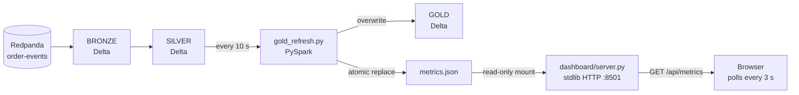

# Live stakeholder dashboard

A read-only web dashboard for the Gold layer. It has **two homes, one page**:

| Where | URL | What it shows |
|-------|-----|---------------|
| Live (local) | `http://localhost:8501` | Real metrics from the running pipeline, refreshed every 3 s |
| Published (GitHub Pages) | `/dashboard.html` | The committed snapshot, clearly labelled **Published snapshot** |

Both are served by the **same file** — `docs/dashboard.html` — so the live view
and the published page can never drift apart.

It shows revenue, orders, sellers, duplicate removal, late-data behaviour and
pipeline health, with four charts and a 3-second auto-refresh. Every number is
derived from the Delta lakehouse — there is no sample data in the UI.

---

## 1. What it shows

| Area | Content |
|------|---------|
| KPI cards | Product revenue, orders created, average order value, sellers, duplicates removed, newest arrival age |
| Charts | Events arriving per minute (all events + `order_created`), payment-mix donut, top-10 sellers by revenue, revenue by hour |
| Pipeline health | Bronze / Silver / Gold / quarantine rows, duplicates removed, watermark, dedup key, Gold version, average/p95/max lateness, refresh state |
| Controls | Pause polling, refresh now, light/dark theme |

The page polls `GET /api/metrics` every 3 seconds and keeps the previous snapshot
visible while a new one is fetched. If no snapshot exists it shows an explicit
**waiting** state instead of inventing values.

### Two hosts, one page

`docs/dashboard.html` carries a deployment marker:

```html
<meta name="p2-deploy" content="static" />
```

- On **GitHub Pages** the marker stays `static`: the page loads the committed
  snapshot (`assets/dashboard_live_metrics.json`), shows a **Published snapshot**
  badge and a banner explaining that live numbers need the local stack.
- The **container** rewrites the marker to `live` when it serves the file, so the
  page polls `/api/metrics` and shows the **Live** / **Stale** / **Disconnected**
  states.

The page never probes a URL that does not exist, so the browser console stays
clean in both modes.

---

## 2. Architecture

The dashboard is deliberately decoupled from Spark and Delta:



Design rules:

- **One implementation of the business logic.** `spark/gold_logic.py` is shared
  by `gold_compaction.py` (end-of-run batch) and `gold_refresh.py` (live
  refresher), so the dashboard cannot disagree with the batch Gold table.
- **One page, two hosts.** `docs/dashboard.html` is the live page *and* the
  published page; only the deployment marker differs.
- **The web server is dumb on purpose.** `dashboard/server.py` has no Spark, no
  Delta reader, no database and no third-party Python packages. It serves one
  HTML file, one JSON file, the static assets and a health endpoint.
- **Atomic snapshots.** `gold_refresh.py` writes a temp file and `os.replace`s
  it, so the server never reads a half-written JSON file.
- **Read-only serving.** The dashboard container mounts `./lakehouse` read-only.
  It cannot mutate the lakehouse.
- **Localhost by default.** Docker Compose binds `127.0.0.1:8501:8501`; the
  service is not exposed on the LAN.
- **No CDN.** The HTML, CSS, JavaScript, webfonts and SVG charts are all served
  from the same origin (the fonts are committed under `docs/assets/fonts/`), so
  the page works offline.


---

## 3. Quick start (live demo)

Prerequisites: Docker Desktop or Colima is running, and you are in the repo root.

```bash
scripts/live_dashboard.sh
# open http://localhost:8501
```

The script:

1. starts Redpanda and Console,
2. ensures the `order-events` topic exists,
3. starts streaming ingestion in a detached container named `p2-ingest`,
4. starts the 10-second Gold refresher and the dashboard, and
5. starts a continuous producer (50 events/s, 10% duplicates, 10% late).

Stop it with:

```bash
scripts/stop_live_dashboard.sh
```

> **This appends to the real `./lakehouse` and `./checkpoints` tables.** That is
> intentional for a live demo, but it means the canonical row counts in the
> README will grow while the producer runs. Use the reset steps in
> [`RUNBOOK.md`](RUNBOOK.md#8-reset) if you want a clean slate.

### Manual commands

```bash
# Build and start the refresher + dashboard only (no producer)
docker-compose --profile dashboard up -d --build gold-refresh dashboard

# Or generate a single snapshot from an existing lakehouse and exit
docker-compose run --rm spark spark-submit \
  --packages io.delta:delta-spark_2.12:3.2.0 \
  /opt/spark/app/gold_refresh.py --once

# Read the existing Gold table and only refresh metrics (no Gold rewrite)
docker-compose run --rm spark spark-submit \
  --packages io.delta:delta-spark_2.12:3.2.0 \
  /opt/spark/app/gold_refresh.py --once --metrics-only
```

The dashboard service alone can serve an existing JSON snapshot:

```bash
docker-compose --profile dashboard up -d dashboard
```

---

## 4. Metrics JSON contract

Path: `/lakehouse/dashboard/metrics.json`
(host: `./lakehouse/dashboard/metrics.json`). `gold_refresh.py` writes it; the
dashboard only reads it.

| Field | Meaning |
|-------|---------|
| `schema_version` | Contract version (`1`) |
| `status` | `live` when the snapshot was built from real tables; `waiting` before Silver exists |
| `generated_at` | UTC time the snapshot was written |
| `refresh_seconds` | Intended refresher cadence |
| `kpis.bronze_rows` | Bronze row count |
| `kpis.silver_rows` | Silver row count |
| `kpis.duplicates_removed` | `bronze_rows - silver_rows - quarantine_rows` |
| `kpis.dedup_rate_pct` | Duplicates as a percentage of Bronze |
| `kpis.gold_rows` | Gold aggregate rows at grain `(hour_start, seller_id, payment_type)` |
| `kpis.total_orders` | Sum of `hourly_order_count` (only `order_created`) |
| `kpis.total_revenue` | Sum of `total_revenue` = `sum(price)` |
| `kpis.avg_order_value` | `total_revenue / total_orders` |
| `kpis.sellers` | Distinct seller IDs in Gold |
| `kpis.data_freshness_seconds` | Wall clock minus newest **Kafka ingestion** timestamp (arrival age, not event time) |
| `kpis.avg_lateness_seconds`, `p95_...`, `max_...` | `kafka_timestamp - event_time` summary |
| `pipeline.watermark` | Watermark in force (`20 minutes`) |
| `pipeline.dedup_keys` | `["event_id", "event_time"]` |
| `pipeline.gold_version` | Delta `DESCRIBE HISTORY` version of Gold |
| `charts.events_by_minute` | Last 60 arrival minutes: `minute`, `events`, `orders`, `revenue` (gross `price + freight_value`; kept for API completeness, not shown in the UI) |
| `charts.revenue_by_hour` | Gold revenue/orders grouped by `hour_start` |
| `charts.top_sellers` | Top 10 sellers by revenue |
| `charts.payment_mix` | Revenue/orders by `payment_type` |

**Accounting identity** (asserted by `tests/verify_dashboard_metrics.py`):

```
bronze_rows == silver_rows + duplicates_removed + quarantine_rows
sum(payment_mix.revenue)     == total_revenue
sum(payment_mix.orders)      == total_orders
sum(revenue_by_hour.revenue) == total_revenue
sum(revenue_by_hour.orders)  == total_orders
```

The identity holds when no rows are in flight between the streaming queries and
the refresh, which is why the test is run on a drained table.

---

## 5. Verified live run

The evidence below is from an **isolated** live run, so it did not touch the
canonical tables:

- Topic: `order-events-dashboard`
- Paths: `/lakehouse/dashboard-demo/{bronze,silver,gold}`,
  `/lakehouse/dashboard-demo/silver/_quarantine`
- Checkpoints: `/checkpoints/dashboard-demo`
- Producer: 60 s at 40 events/s, 10% duplicates, 10% late
- Stream started **before** the producer; refresher every 5 s for the test
  (the shipped default is 10 s)

### Counts climbed while the dashboard was open

| Snapshot | Bronze | Silver | Gold rows | Orders | Revenue | Newest arrival |
|----------|-------:|-------:|----------:|-------:|--------:|---------------:|
| t1 | 926 | 708 | 60 | 238 | 56,345.40 | 6.4 s |
| t2 | 1,726 | 1,438 | 60 | 519 | 128,841.28 | 6.9 s |
| final | 2,616 | 2,415 | 96 | 863 | 219,392.90 | 40.7 s |

- Duplicates removed: **201** (7.68%); quarantine: **0**.
- `numRowsDroppedByWatermark = 0` for the whole run.
- The refresher completed **20 cycles**, Gold version `0 → 19`. The committed
  API snapshot was captured at version **11**; counts were unchanged after
  version 9, and the log shows the later versions still refreshing the same
  snapshot.
- The browser DOM showed status **Live**, KPIs `$219,393 / 863 / $254.22 / 20 /
  201`, 10 seller bars, 2 hourly bars and 4 donut SVG elements, with **zero
  console errors**.

Independent checks (`docs/assets/dashboard_live_verify.txt`):

```
Silver rows                 : 2415
Distinct event_id           : 2415
Distinct (event_id, time)   : 2415
Bronze distinct dedup keys  : 2415
Rows with bad total_amount  : 0
PASS verify_silver_dedup

[verify_gold] gold rows          = 96
[verify_gold] duplicate grain keys = 0
[verify_gold] order_count  gold=863 independent=863
[verify_gold] total_revenue gold=219392.9 independent=219392.9
[verify_gold] mismatched groups = 0
PASS: gold matches independent recomputation from silver
```

Committed evidence:

- [`assets/dashboard_live_metrics.json`](assets/dashboard_live_metrics.json) —
  captured API payload from the live run (Gold version 11).
- [`assets/dashboard_live_refresh.txt`](assets/dashboard_live_refresh.txt) —
  all 20 refresher cycles, including version and row counts.
- [`assets/dashboard_live_ingest.txt`](assets/dashboard_live_ingest.txt) —
  streaming progress, including `numRowsDroppedByWatermark=0`.
- [`assets/dashboard_live_verify.txt`](assets/dashboard_live_verify.txt) —
  independent Silver/Gold verification.
- [`assets/dashboard_canonical_metrics.json`](assets/dashboard_canonical_metrics.json)
  — snapshot from the canonical dataset.

### Canonical snapshot

Running `gold_refresh.py --once --metrics-only` against the canonical tables
produced the documented numbers without rewriting Gold:

| Metric | Value |
|--------|-------|
| Bronze rows | 3,277 |
| Silver rows | 3,018 |
| Duplicates removed | 259 (7.90%) |
| Gold rows | 60 |
| Orders | 1,055 |
| Product revenue | 269,805.58 |
| Gold version | 2 (preserved by `--metrics-only`) |

`python3 tests/verify_dashboard_metrics.py docs/assets/dashboard_canonical_metrics.json`
passes. The canonical dataset is historical, so its "newest arrival" is hours old
and the UI may show **Stale snapshot**; a live run shows seconds.

---

## 6. Cloud verification (free GitHub Actions)

The cloud workflow generates dashboard metrics **after** Gold compaction:

```bash
docker compose run --rm -T --no-deps spark spark-submit \
  --packages io.delta:delta-spark_2.12:3.2.0 \
  /opt/spark/app/gold_refresh.py --once --metrics-only
```

`--metrics-only` reads the existing Gold table and writes only the JSON. It does
**not** rewrite Gold, so it cannot undo `OPTIMIZE`/ZORDER or bump the Gold
version. The workflow then builds and starts the dashboard container, calls
`/healthz` and `/api/metrics`, and runs
`python3 tests/verify_dashboard_metrics.py` on the returned JSON.

The checks are **invariant-based** (accounting identity, sorted series, top-10
limit, lateness ordering), not hardcoded canonical counts, because workflow
inputs are configurable. Artifacts:

- `dashboard_refresh.txt` — refresher log (`Mode:`, `REFRESH`, `One-shot`)
- `dashboard_metrics.json` — the exact API payload
- `dashboard_health.json` — health endpoint response
- `verify_dashboard_metrics.txt` — contract + KPI output

CI deliberately does **not** start the continuous refresher: a finite workflow
should not leave a long-lived service running. `--once` is sufficient to verify
the contract.

---

## 7. Design decisions and limits

| Decision | Why | Limit / production upgrade |
|----------|-----|----------------------------|
| Full recompute every 10 s | Thousands of rows; late events are automatically correct without MERGE bookkeeping | At scale, switch to incremental `foreachBatch` + `MERGE` |
| Gold `overwrite` each cycle | Idempotent and simple for a derived aggregate | Creates a new Delta version per cycle; skip the write when Silver's version is unchanged, or use MERGE |
| `OPTIMIZE` outside the loop | Rewriting files every 10 s would be wasteful | Keep compaction as a scheduled job (`gold_compaction.py`) |
| Polling every 3 s | Simple, robust, no WebSocket/SSE infrastructure | SSE/WebSocket for sub-second updates |
| Read-only static server | Tiny supply chain, starts in milliseconds, cannot mutate data | Add auth/TLS before exposing beyond localhost |
| No CDN | Works offline and in restricted networks; fonts are committed under `docs/assets/fonts/` | None for this use case |
| One page, two hosts | The live view and the published page cannot drift apart | Split the files if the two UIs ever diverge in purpose |
| Top 10 sellers / 60 minutes / 12 hours | Keeps the JSON small and the UI readable | Add filters/date range and pagination for a real BI tool |

The dashboard is **not** a BI tool: it has no ad-hoc query layer. Gold is the
contract; anything more exploratory belongs in SQL/notebooks against Delta.

### Visual design

The page uses the same design system as the showcase site (`docs/assets/site.css`):

- **Aesthetic** — "control room": graphite ground, blueprint grid, hairline
  rules, drafting corner ticks, one signal-amber accent on a teal data colour.
- **Type** — Bricolage Grotesque (display) · IBM Plex Sans (body) · IBM Plex Mono
  (data), all self-hosted. No system font, no CDN.
- **Motion** — one entrance sequence, animated flow line on the site schematic,
  3 s poll. Everything respects `prefers-reduced-motion`.

---

## 8. Troubleshooting

| Symptom | Cause | Fix |
|---------|-------|-----|
| "Waiting for data" | Silver table does not exist yet | Start `stream_ingestion.py`; check `docker logs p2-ingest` |
| "Stale snapshot" | The refresher stopped or the JSON is older than the freshness threshold | Restart `gold-refresh`; check its logs |
| Page shows "Published snapshot" | You opened the GitHub Pages copy, not the local server | Use `http://localhost:8501` (the container rewrites the deploy marker) |
| Dashboard is healthy but KPIs are empty | `METRICS_PATH` points somewhere else | Ensure both services use `/lakehouse/dashboard/metrics.json` |
| Port 8501 already in use | Another dashboard/container is running | Stop it or change the Compose port mapping |
| Fonts do not load in the container | The image is stale | Rebuild: `docker-compose --profile dashboard build --no-cache dashboard` |
| `--metrics-only` exits with "Gold table not found" | Gold has not been built | Run `gold_compaction.py` first, or omit `--metrics-only` |
| Permission denied writing `metrics.json` | Host volume permissions | Ensure `./lakehouse` is writable by the refresher container |
| Docker daemon not running | Colima/Docker Desktop stopped | Start it; `docker info` should succeed |

For the full stack, see [`RUNBOOK.md`](RUNBOOK.md). For the design rationale,
see [`CONCEPTS_AND_DESIGN_DECISIONS.md`](CONCEPTS_AND_DESIGN_DECISIONS.md).
